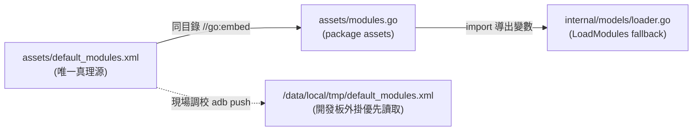

# XML 模組配置架構說明 (Single Source of Truth)

## 設計架構

在 QWifiTestTool 中，全系統僅維護**唯一一份實體模組設定檔**：
* **`assets/default_modules.xml`**

### 架構演進：消除雙檔案同步陷阱

過去因為 Go `//go:embed` 不允許存取上層目錄（`..`），專案曾在 `internal/models/` 複製了另一份 `default_modules.xml` 並依賴腳本複製，導致 IDE / VS Code 直接 Run/Debug 時改動不生效。

現已全面重構為 **`package assets` 微型嵌入模組架構**：

1. **`assets/modules.go`** 與 `default_modules.xml` 位於同一個目錄，合法執行 `//go:embed default_modules.xml` 導出 `assets.DefaultModulesXML`。
2. **`internal/models/loader.go`** 直接 `import "qwifitesttool/assets"`，完全免除實體檔案複製。
3. 不管是 IDE (VS Code / GoLand) 直接 F5、命令列執行 `go run`、`go test` 或 `go build`，編譯器直接抓取 `assets/default_modules.xml`，**修改 100% 保證即時生效**。

---

## 運行時載入優先權

`models.LoadModules()` 採用雙軌防護策略：

| 順序 | 載入來源 | 說明 | 適用情境 |
|:---:|:---|:---|:---|
| **1 (優先)** | 開發板/系統外部檔案 | `/data/local/tmp/default_modules.xml` 或執行檔旁 | 現場人員免重新編譯，直接 `vi` 外部 XML 調校參數即時生效 |
| **2 (保底)** | 程式二進制內嵌版本 | `assets.DefaultModulesXML` | 開發板無任何外掛檔案時，保證 100% 自主運作（防漏推） |

> **防呆機制**：若板端存在外部檔案且內容與內嵌預設版本不同，系統將自動印出黃色警告提示 `[INFO] 偵測到自訂外部配置 (與程式內嵌版本不同)`，避免板端過期殘留檔案遮蔽新版程式的預期行為。

