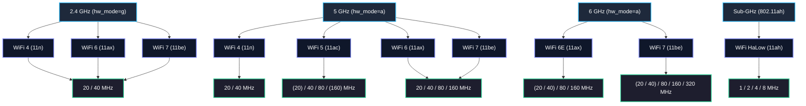
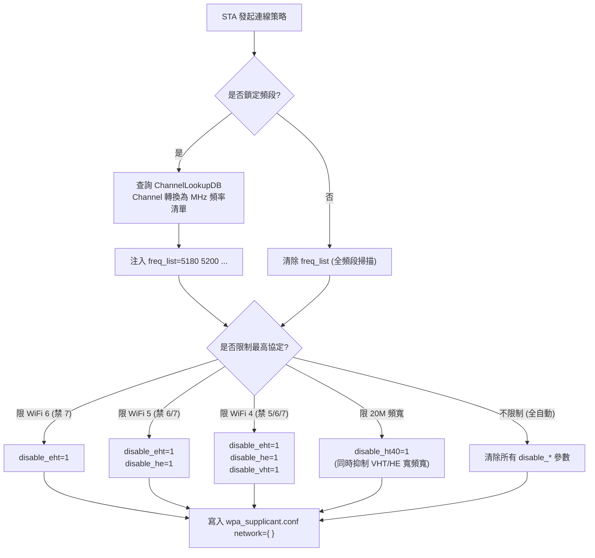

# WiFi Band / Protocol / Bandwidth 矩陣關係與參數聯動簡報大綱 (v2 審定修正版)

> 本文檔統合整理自 [protocol_bandwidth_preset_design.md](file:///d:/QWiFiTestTool/QWifiTestTool/docs/protocol_bandwidth_preset_design.md)，並依據 hostapd / wpa_supplicant 2.11 上游源碼與 802.11-2020 / 802.11be 標準進行技術校正與補強。

---

## 簡報架構總覽 (Slide Deck Overview)

| Slide | 標題 | 形式 | 核心訴求 |
| :---: | :--- | :--- | :--- |
| **01** | **階層約束架構** | Mermaid 樹狀圖 | 釐清 Band ➔ Protocol ➔ Bandwidth 的單向物理與邏輯邊界 |
| **02** | **全規格支援相容性矩陣** | 三態符號矩陣表 | 以 `✅/○/❌` 標註工具預設、標準允許與標準禁止邊界 |
| **03** | **信道聚合與中心頻率圖解** | 階梯信道圖 (ASCII/圖解) | 拆解 5GHz ch36–64 聚合過程，直觀理解 Center 42 / 50 算法 |
| **04** | **切換影響矩陣 (Core)** | 三向維度影響表 | 橫軸 Band / Proto / BW，縱軸各參數，直觀解答「切換時改哪些參數」 |
| **05** | **AP 參數映射總表** | 鍵值對照表 | `hw_mode`, `ieee80211*`, `*_oper_chwidth`, `op_class` 具體值 |
| **06** | **AP 物理陷阱與設計防呆** | 三欄技術卡片 | 6G op_class/SAE、5G DFS 跨界/CAC、2.4G 禁 VHT 與 全頻段 WMM/CCMP |
| **07** | **STA 模式：被動協商與主動抑制** | 決策樹流程圖 | STA 透過 `freq_list`、`disable_*` 與 `disable_ht40` 強制降級 |
| **08** | **STA 參數映射與 Scope 陷阱** | 語法對照 + 警示 | `network={}` 內部注入、全域 Unknown Field Fatal 警告與 MHz 轉換 |
| **09** | **實戰演練：跨代切換 Diff 對照** | 配置 Diff 視圖 | 2.4G 11n-20M ⇄ 6G 11be-320M 的實際 hostapd.conf 完整 Diff |

---

## Slide 01: 階層約束架構 (Hierarchy & Constraints)

### 投影片內容
- **核心觀念**：非自由笛卡兒積，由底層物理至高層邏輯單向嚴格約束。
- **三層約束**：
  1. **Band（頻段）**：決定物理 RF 模式 (`hw_mode=a/g`)、可用信道池、EIRP / DFS 規範。
  2. **Protocol（協定）**：決定調變上限、向下相容性旗標、STA 協商 IE。
  3. **Bandwidth（頻寬）**：決定信道聚合（Bonding）、中心頻率計算公式與 `op_class`。

### 圖示：階層約束樹 (Mermaid)

> *(括號) 代表標準允許但工具預設未列入快捷選單之規格。*

---

## Slide 02: 全規格支援相容性矩陣 (Compatibility Matrix)

### 圖例說明
- `✅`：**工具提供預設** (QWiFiTestTool Quick Preset)
- `○`：**標準允許但工具未預設** (非主流測試組合，可透過手動配置達成)
- `❌`：**標準禁止 / 物理邊界** (驅動拒載或違反 802.11 規範)

### 規格矩陣表
| 頻段 (Band) | 協定代號 (Std) | 20M | 40M | 80M | 160M | 320M | 邊界約束與備註 |
| :--- | :--- | :---: | :---: | :---: | :---: | :---: | :--- |
| **2.4 GHz** | **WiFi 4 (11n)** | ✅ | ✅ | ❌ | ❌ | ❌ | 40M 需動態計算 `[HT40+]` 或 `[HT40-]` |
| | **WiFi 5 (11ac)** | ❌ | ❌ | ❌ | ❌ | ❌ | **標準禁止**：802.11ac 僅定義於 5GHz，2.4G 啟用會導致啟動失敗 |
| | **WiFi 6 (11ax)** | ✅ | ✅ | ❌ | ❌ | ❌ | 保留 `ieee80211n=1`，WMM/CCMP 必開 |
| | **WiFi 7 (11be)** | ✅ | ✅ | ❌ | ❌ | ❌ | 2.4G 無 80M/160M 頻譜空間 |
| **5 GHz** | **WiFi 4 (11n)** | ✅ | ✅ | ❌ | ❌ | ❌ | 802.11n 最大頻寬僅 40MHz |
| | **WiFi 5 (11ac)** | ○ | ✅ | ✅ | ○ | ❌ | 80M 需計算 VHT Center；160M 跨 DFS 標準允許但非預設 |
| | **WiFi 6 (11ax)** | ✅ | ✅ | ✅ | ✅ | ❌ | 160M Center 偏移計算；覆蓋 DFS 時需啟用 802.11h |
| | **WiFi 7 (11be)** | ○ | ○ | ✅ | ✅ | ❌ | 5GHz 無 320MHz 頻譜空間；主要預設 80M/160M |
| **6 GHz** | **WiFi 6E (11ax)** | ○ | ○ | ✅ | ✅ | ❌ | 頻寬由 `op_class` 唯一仲裁；強制 WPA3-SAE / PMF |
| | **WiFi 7 (11be)** | ○ | ○ | ✅ | ✅ | ✅ | **唯一支援 320M** (`op_class=137`)；中心頻道 EHT/HE 雙偏移 |
| **Sub-GHz** | **WiFi HaLow (11ah)**| - | - | - | - | - | 專屬 1M/2M/4M/8M (如 Quectel FGH200M，hw_mode=a) |

---

## Slide 03: 信道聚合 (Bonding) 與中心信道計算圖解

> 以 5 GHz UNII-1 / UNII-2A (ch36–64) 為例，直觀呈現主信道 (Primary Channel) 與中心信道 (Center Channel) 的推算邏輯。

```text
信道號:   36   40   44   48   52   56   60   64
頻率:    5180 5200 5220 5240 5260 5280 5300 5320 (MHz)
         ─────────────────── ───────────────────
         UNII-1 (Non-DFS)    UNII-2A (DFS 頻段)

[20 MHz] [36] [40] [44] [48] [52] [56] [60] [64]  --> 主信道 (如 ch=36)
          └─┬─┘     └─┬─┘     └─┬─┘     └─┬─┘
[40 MHz]   [  38+ ]  [  46+ ]  [  54+ ]  [  62+ ]  --> ht_capab=[HT40+]
             └───┬───┘           └───┬───┘
[80 MHz]     [        Center: 42        ]          --> vht/he_oper_centr_freq_seg0_idx=42
                         └───────────────┬───────────────┘
[160 MHz]                [              Center: 50              ] --> seg0_idx=50 (跨入 DFS!)
```

### 核心計算規則
1. **40 MHz (HT40+/HT40-)**：
   - 次信道在主信道上方 ➔ `HT40+`（主信道 36, 44, 52, 60）
   - 次信道在主信道下方 ➔ `HT40-`（主信道 40, 48, 56, 64）
2. **80 MHz Center**：
   - 區塊起始信道 + 6 ➔ $36 + 6 = 42$
3. **160 MHz Center**：
   - 區塊起始信道 + 14 ➔ $36 + 14 = 50$
4. **6 GHz 320 MHz Center (Block 1)**：
   - 區塊起始信道 1 + 30 ➔ Center = 31 (覆蓋 ch1–ch61，跨越四個 80MHz 區塊)

---

## Slide 04: 切換影響矩陣 (Switching Impact Matrix)

> 橫向為測試者切換的三大維度，縱向為底層設定檔參數。此頁直接解答「切換時到底改了什麼」。

| 設定檔參數 | 切換 Band (頻段) | 切換 Protocol (協定) | 切換 Bandwidth (頻寬) |
| :--- | :---: | :---: | :---: |
| `hw_mode` | **受影響** (`g` ⇄ `a`) | 不變 | 不變 |
| `channel` | **受影響** (信道池完全置換) | 不變 | **受影響** (需檢核是否落在聚合合法邊界) |
| `ieee80211n` | **受影響** (6G 關閉，2.4G/5G 開啟) | **受影響** (11n 專屬或相容開關) | 不變 |
| `ieee80211ac` | **受影響** (2.4G 嚴禁，5G 開啟，6G 關閉) | **受影響** (11ac/ax/be 開啟) | 不變 |
| `ieee80211ax` | 不變 | **受影響** (WiFi 6/6E/7 開啟) | 不變 |
| `ieee80211be` | 不變 | **受影響** (WiFi 7 專屬開啟) | 不變 |
| `ht_capab` | **受影響** (決定 HT40 擴展方向) | 不變 | **受影響** (20M: `[HT20]`, 40M: `[HT40+/-]`) |
| `vht_oper_chwidth` | 不變 (僅 5G 有效) | 不變 | **受影響** (80M=1, 160M=2) |
| `he_oper_chwidth` | **受影響** (6G 由 op_class 覆蓋) | 不變 | **受影響** (5G: 80M=1, 160M=2) |
| `eht_oper_chwidth` | **受影響** (6G 由 op_class 覆蓋) | 不變 | **受影響** (5G: 80M=1, 160M=2) |
| `op_class` | **受影響** (僅 6G 必需顯式設定) | 不變 | **受影響** (6G: 131/132/133/134/137) |
| `*_centr_freq_seg0_idx` | **受影響** (計算基準頻段不同) | 不變 | **受影響** (重新計算 42 / 50 / 31 / 47) |
| `wpa / wpa_key_mgmt` | **受影響** (6G 強制 SAE，其餘可 WPA2) | 不變 | 不變 |
| `ieee80211w` (PMF) | **受影響** (6G 強制 `=2`，其餘可選) | 不變 | 不變 |
| `ieee80211h` / `dfs` | **受影響** (5G DFS 必開，2.4G/6G 關閉) | 不變 | **受影響** (頻寬擴展跨入 DFS 區段時觸發) |

---

## Slide 05: AP 參數映射總表 (hostapd.conf Parameter Mapping)

### 表 1：驅動與協定開關
| 規格組合 | `hw_mode` | `ieee80211be` | `ieee80211ax` | `ieee80211ac` | `ieee80211n` | `wmm_enabled` | `wpa_key_mgmt` |
| :--- | :---: | :---: | :---: | :---: | :---: | :---: | :---: |
| **2.4G 11n** | `g` | - | - | **0 (禁止)** | 1 | **1 (必開)** | WPA-PSK / SAE |
| **2.4G 11ax** | `g` | - | 1 | **0 (禁止)** | 1 | **1 (必開)** | WPA-PSK / SAE |
| **2.4G 11be** | `g` | 1 | 1 | **0 (禁止)** | 1 | **1 (必開)** | WPA-PSK / SAE |
| **5G 11n** | `a` | - | - | - | 1 | 1 | WPA-PSK / SAE |
| **5G 11ac** | `a` | - | - | 1 | 1 | 1 | WPA-PSK / SAE |
| **5G 11ax** | `a` | - | 1 | 1 | 1 | 1 | WPA-PSK / SAE |
| **5G 11be** | `a` | 1 | 1 | 1 | 1 | 1 | WPA-PSK / SAE |
| **6G 11ax** | `a` | - | 1 | **0** | **0** | 1 | **SAE (強制)** |
| **6G 11be** | `a` | 1 | 1 | **0** | **0** | 1 | **SAE (強制)** |

### 表 2：頻寬與中心信道參數
| 目標規格 | `vht_oper_chwidth` | `he_oper_chwidth` | `eht_oper_chwidth` | `op_class` | 中心信道索引 (seg0_idx) |
| :--- | :---: | :---: | :---: | :---: | :--- |
| **6G be-320M** | - | *(忽略)* | *(忽略)* | **137** | `eht_idx=31`, `he_idx=47` (ch37 為例) |
| **6G be-160M** | - | *(忽略)* | *(忽略)* | **134** | `eht_idx=47`, `he_idx=47` |
| **6G be-80M** | - | *(忽略)* | *(忽略)* | **133** | `eht_idx=39`, `he_idx=39` |
| **6G ax-160M** | - | *(忽略)* | - | **134** | `he_idx=47` |
| **6G ax-80M** | - | *(忽略)* | - | **133** | `he_idx=39` |
| **5G be/ax-160M**| 2 | 2 | 2 | 自動 | `calcVHTCenterChannel(ch, 160)` ➔ 50 |
| **5G be/ax/ac-80M**| 1 | 1 | 1 | 自動 | `calcVHTCenterChannel(ch, 80)` ➔ 42 |
| **5G / 2.4G 40M**| 0 | 0 | 0 | - | `ht_capab=[HT40+]` 或 `[HT40-]` |
| **20M (所有頻段)**| 0 | 0 | 0 | - | `ht_capab=[HT20]` |

> **上游重要實作機制**：在 hostapd 2.11 中，**6 GHz 頻段頻寬以 `op_class` 為絕對依據**，`he/eht_oper_chwidth` 參數會被略過。`op_class` 填錯（如 40M 誤填 131）會導致驅動信道頻寬初始化失敗。

---

## Slide 06: AP 物理陷阱與設計防呆 (Gotchas & Physics)

### 投影片內容（三欄技術卡片）

#### 1. 6 GHz 規範強制約束
- **強制 WPA3-SAE / PMF**：6 GHz 嚴禁 Pre-RSNA 安全模式。必須保留 `wpa=2`，並設定 `wpa_key_mgmt=SAE` 與 `ieee80211w=2`（PMF 強制開啟）。
- **`op_class` 唯一仲裁**：320M=`137`、160M=`134`、80M=`133`、40M=`132`、20M=`131`。
- **PSC 首選掃描信道**：主信道建議優先選用 Preferred Scanning Channels (37, 53, 69, 85...)，避免 STA 逐頻掃描超時。

#### 2. 5 GHz 頻寬對齊與 DFS 跨界陷阱
- **中心信道偏移**：80M/160M 必須對齊標準 Block（ch36 ➔ 80M Center: 42, 160M Center: 50）。
- **DFS 跨界懲罰**：主信道選在 Non-DFS 的 ch36，開 **160 MHz** 時頻寬會橫跨至 ch52–64（UNII-2A DFS 頻段）！
  - **必備配置**：必須注入 `country_code`、`ieee80211d=1` 與 `ieee80211h=1`。
  - **CAC 等待**：開機後需進行 Channel Availability Check（靜默雷達探測 $\ge 60$ 秒），期間不發射 Beacon。

#### 3. 2.4 GHz 邊界與 全頻段 WMM/CCMP
- **嚴禁 802.11ac**：2.4G 啟用 `ieee80211ac=1` 會在 VHT 能力檢查階段導致 interface 初始化失敗，或發出違規 VHT IE。
- **WMM 強制適用全頻段**：802.11n/ac/ax/be 在任何頻段均依賴 WMM。未啟用 `wmm_enabled=1` 會被 STA 降級為 legacy 802.11a/g (54 Mbps)。
- **加密套件鎖定 CCMP**：HT 以上協定強制使用 CCMP/GCMP；若設定 `wpa_pairwise=TKIP`，hostapd 會主動關閉 HT 降速至 54 Mbps。

---

## Slide 07: STA 模式：被動協商與主動抑制

### 投影片內容
- **測試痛點**：Linux STA 預設完全聽從 AP Beacon 廣播，無法單獨驗證網卡在舊規格的向下相容表現。
- **主動抑制技術**：
  1. **頻段鎖定 (`freq_list`)**：白名單機制，限制 STA 只掃描與只連線特定頻率。
  2. **協定降級 (`disable_*`)**：黑名單機制，遮蔽 STA 自身的高階能力 IE。
  3. **頻寬限制 (`disable_ht40`)**：抑制 40MHz 及以上頻寬，強制以 20MHz 運作。



---

## Slide 08: STA 參數映射與 Scope 陷阱 (wpa_supplicant.conf)

### 投影片內容

#### 參數注入映射表
| 策略項目 | UI 選項 | 注入參數語法 (`network={ ... }`) | 上游原始碼行為與效果 |
| :--- | :--- | :--- | :--- |
| **頻段鎖定** | 鎖定 2.4 GHz | `freq_list=2412 2417 2422 ... 2472` | 僅允許選擇 2.4GHz BSS 連線 |
| | 鎖定 5 GHz (無 DFS) | `freq_list=5180 5200 5220 5240 5745 ... 5825` | 排除 DFS 信道，消除雷達被動掃描耗時 |
| | 鎖定 6 GHz | `freq_list=5955 5975 6035 ...` | 僅連線 6GHz 頻段 (MHz 單位) |
| **協定降級** | 最高 WiFi 6 | `disable_eht=1` | Association Request 隱藏 EHT Capabilities |
| | 最高 WiFi 5 | `disable_eht=1`<br>`disable_he=1` | 同時隱藏 EHT 與 HE Capabilities |
| | 最高 WiFi 4 | `disable_eht=1`<br>`disable_he=1`<br>`disable_vht=1` | 僅發送 HT Capabilities |
| **頻寬限制** | 強制 20 MHz | `disable_ht40=1` | 關閉 40M 支撐，連鎖抑制 VHT/HE 寬頻寬 |

#### ⚠️ 關鍵區分：全域 Scope vs Network Scope 陷阱
```ini
# ❌ 嚴重錯誤：寫在全域 (Global Scope)
ctrl_interface=/var/run/wpa_supplicant
update_config=1
disable_eht=1    # <--- FATAL ERROR: "Line X: unknown global field 'disable_eht'" (整份 conf 載入失敗崩潰！)
freq_list=5180   # <--- 語意偏差：全域 freq_list 僅限制掃描 (Scan Frequency)，不約束最終 BSS 選擇！

# ✅ 正確做法：注入到目標網路塊內部 (Network Scope)
ctrl_interface=/var/run/wpa_supplicant
update_config=1

network={
    ssid="Target_AP"
    psk="12345678"
    freq_list=5180 5200 5220 5240   # 精準約束此網路僅連線上述頻率
    disable_eht=1                   # 合法 network 參數：禁用 WiFi 7
    disable_ht40=1                  # 合法 network 參數：強制 20MHz 測試
}
```

---

## Slide 09: 實戰演練：跨代切換 Diff 對照

### 投影片內容
- 展示從 `2.4G WiFi 4 (20M)` 切換至 `6G WiFi 7 (320M)` 時，底層 `hostapd.conf` 的精確 Diff。

```diff
  # /etc/hostapd.conf 變更差異
- hw_mode=g
+ hw_mode=a
- channel=1
+ channel=37
- ht_capab=[HT20]
+ op_class=137
- ieee80211n=1
+ ieee80211ax=1
+ ieee80211be=1
+ he_oper_centr_freq_seg0_idx=47
+ eht_oper_centr_freq_seg0_idx=31
  wpa=2
- wpa_key_mgmt=WPA-PSK
+ wpa_key_mgmt=SAE
- wpa_pairwise=TKIP CCMP
+ wpa_pairwise=CCMP
+ ieee80211w=2
+ sae_pwe=2
```

> **Diff 技術亮點備註**：
> 1. `wpa=2` **必須保留**，不可刪除（6GHz 強制要求 RSN）。
> 2. `ieee80211n=1` **明確移除**（6GHz 為原生 HE/EHT，無 11n/11ac）。
> 3. `seg0_idx` **雙中心頻率**：HE 160M 區塊中心為 `47`，EHT 320M 區塊中心為 `31`。
> 4. `op_class=137` **仲裁 320M 頻寬**，無需指定 `eht_oper_chwidth=3`。

---

## 🎯 簡報總結金句 (Key Takeaways)

1. **AP 模式核心**：6 GHz 頻寬由 `op_class` 唯一仲裁；5 GHz 跨 160M 必伴隨 DFS 與 CAC 機制；WMM 與 CCMP 適用於全頻段。
2. **STA 模式核心**：全域 `disable_*` 會導致 conf 解析崩潰；頻寬受制於 `disable_ht40=1`；必須於 `network={}` 內實施頻率與能力遮蔽。
3. **自動化工具價值**：動態換算頻道與中心頻率偏移、自動注入法規防呆（DFS / PMF / WMM），杜絕底層驅動啟動失敗。
