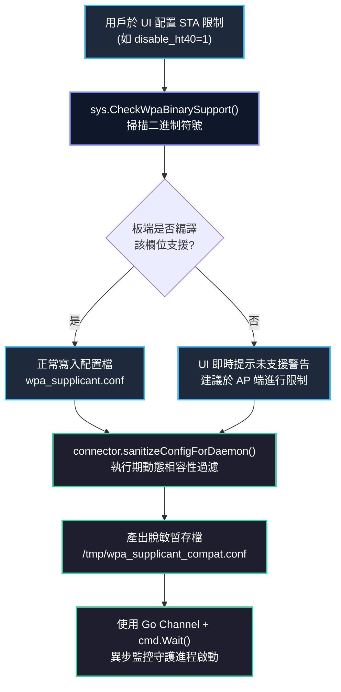

# QWiFiTestTool - AP/STA 快速頻段與協定頻寬配置功能設計文檔 (v5)

> **版本**: v5 (2026-09-29)
> **狀態**: 全面實作與驗證完成（含 6G PSC 反推映射、STA 頻寬抑制 `disable_ht40`、執行期二進制相容性探測與動態 Sanitization 防呆）

## 1. 背景與需求

在 WiFi 測試與認證過程中，頻段（Band: 2.4G / 5G / 6G / Sub-GHz）、協定（Protocol: 11be / 11ax / 11ac / 11n / 11ah）與頻寬（Bandwidth: 320M / 160M / 80M / 40M / 20M / 2M）的組合繁多且存在嚴格物理邊界：
- **AP 模式**：
  - 5GHz 頻寬跨入 DFS（如 160M Center 50）若未設定 `ieee80211h=1` 會直接觸發 hostapd 崩潰；
  - 6GHz 頻寬由 `op_class`（131~137）唯一仲裁，且主頻道必須為 Preferred Scanning Channel (PSC: 37, 53, 69...)，若直接使用頻道資料庫邊界頻道（如 ch33），STA 端將因被動掃描機制而無法發現熱點；
  - 2.4GHz 嚴禁啟用 802.11ac (VHT)，且 11n/ax/be 均強制依賴 WMM 與 CCMP。
- **STA 模式**：
  - Linux 預設由 AP Beacon 決定連線規格，缺乏主動鎖定頻段或強制協定降級（如禁用 WiFi 7 測試 WiFi 6 向下相容）的手段；
  - 若直接寫入全域或板端未編譯的 override 參數（如 `CONFIG_HT_OVERRIDES`），`wpa_supplicant` 會直接拋出 `unknown field` 致命錯誤退出。

本功能提供**直覺式的規格預設精靈**與**多層執行期防呆防禦體系**，在 AP 與 STA 模式下實現一鍵合規配置與零崩潰測試。

---

## 2. 操作模式與交互設計

對齊專案的主選單架構：
```text
========== 操作模式 ==========
[1] 診斷 (Sanity Check)
[2] 編輯 wpa_supplicant.conf
[3] Station 模式 (連接 WiFi)
[4] Hostapd/Dnsmasq 配置生成及修改
[5] AP 模式 (建立熱點)
[0] 退出
============================
```

### 2.1 AP 模式：嵌入選單 `[4]` 的子選單

用戶在主選單輸入 `4` 進入 AP 配置主選單，保持現有選項編號不變，以追加項目方式整合：

```text
[1] 修改當前配置
[2] 捨棄舊設定，重新生成 (使用 XML 預設值)
[3] 從預設情境範本載入 (快速套用 11n/ac/ax 等情境)
[4] ⚡ 快速規格預設精靈 (頻段/協定/頻寬一鍵配置)  <--- 快速精靈入口
[0] 退出不修改
```

#### 操作流程：
1. **第一層：選擇頻段**（依據當前模組 `Capabilities` 自動過濾，並動態標注模組能力上限）：
   ```text
   請選擇頻段:
     [1] 2.4 GHz (最高: be-40M)
     [2] 5 GHz   (最高: be-160M)
     [3] 6 GHz   (最高: be-320M)
     [4] Sub-GHz (802.11ah)              ← 僅 HaLow 模組顯示
     [0] 返回
   ```
   - 若模組不支援某頻段（如無 6G），該選項**不顯示**。
   - 括號內的「最高」標注由 `Capabilities.MaxBandwidth` 和 `Capabilities.Modes` 動態計算。

2. **第二層：選擇協定與頻寬組合**：
   - **5 GHz 預設清單（共 14 項）**：
     ```text
     請選擇 5 GHz 規格預設:
       [1] WiFi 7 (802.11be) - 160 MHz  [推薦頻道: 36, Center: 50]
       [2] WiFi 7 (802.11be) - 80 MHz   [推薦頻道: 36, Center: 42]
       [3] WiFi 7 (802.11be) - 40 MHz   [推薦頻道: 36]
       [4] WiFi 7 (802.11be) - 20 MHz   [推薦頻道: 36]
       [5] WiFi 6 (802.11ax) - 160 MHz  [推薦頻道: 36, Center: 50]
       [6] WiFi 6 (802.11ax) - 80 MHz   [推薦頻道: 36, Center: 42]
       [7] WiFi 6 (802.11ax) - 40 MHz   [推薦頻道: 36]
       [8] WiFi 6 (802.11ax) - 20 MHz   [推薦頻道: 36]
       [9] WiFi 5 (802.11ac) - 160 MHz  [推薦頻道: 36, Center: 50]
      [10] WiFi 5 (802.11ac) - 80 MHz   [推薦頻道: 36, Center: 42]
      [11] WiFi 5 (802.11ac) - 40 MHz   [推薦頻道: 36]
      [12] WiFi 5 (802.11ac) - 20 MHz   [推薦頻道: 36]
      [13] WiFi 4 (802.11n)  - 40 MHz   [推薦頻道: 36]
      [14] WiFi 4 (802.11n)  - 20 MHz   [推薦頻道: 36]
       [0] 返回
     ```
   - **6 GHz 預設清單（共 9 項）**：
     ```text
     請選擇 6 GHz 規格預設:
       [1] WiFi 7 (802.11be) - 320 MHz  [中心頻道: 31, Primary: 37 (PSC)]
       [2] WiFi 7 (802.11be) - 160 MHz  [中心頻道: 47, Primary: 37 (PSC)]
       [3] WiFi 7 (802.11be) - 80 MHz   [中心頻道: 39, Primary: 37 (PSC)]
       [4] WiFi 7 (802.11be) - 40 MHz   [中心頻道: 35, Primary: 37 (PSC)]
       [5] WiFi 7 (802.11be) - 20 MHz   [推薦頻道: 37 (PSC)]
       [6] WiFi 6 (802.11ax) - 160 MHz  [中心頻道: 47, Primary: 37 (PSC)]
       [7] WiFi 6 (802.11ax) - 80 MHz   [中心頻道: 39, Primary: 37 (PSC)]
       [8] WiFi 6 (802.11ax) - 40 MHz   [中心頻道: 35, Primary: 37 (PSC)]
       [9] WiFi 6 (802.11ax) - 20 MHz   [推薦頻道: 37 (PSC)]
       [0] 返回
     ```
   - **2.4 GHz 預設清單（共 6 項）**：
     - WiFi 7 (40M / 20M)、WiFi 6 (40M / 20M)、WiFi 4 (40M / 20M)。

3. **6GHz PSC 主頻道反推映射機制**：
   - 頻道庫 (`country_channel_lookup.json`) 中定義的多為各頻寬區塊的起始信道（如 160M 的 `1`, `33`）。
   - 為避免直接寫入起始頻道造成 STA 掃描超時，配置產生器會先計算該區塊的中心頻道（`calcHE6GCenterChannel()`），再透過 `CalcPrimaryChannel6G(center, bw)` 反推合法 PSC（如中心頻道 47 反推為 PSC 37），並將其寫入 `hostapd.conf` 的 `channel=` 欄位。

4. **保留用戶憑證與一鍵套用**：
   - 快速精靈設定 `Band`, `Mode`, `Bandwidth`, `Channel`, `Security`（6G 強制 WPA3-SAE）。
   - 保留既有已設定的 `SSID`、`Password` 與 `CountryCode`。
   - 提示：`✅ 已成功套用 6G be-160M 規格 (Center: 47) (Primary: 37)`。

---

### 2.2 STA 模式：嵌入選單 `[2] 編輯 wpa_supplicant.conf`

> **設計原則**：不在 `[3] Station 模式` 的掃描→連線流程中插入繁複提問，保持連線流暢度。所有策略配置在 `[2]` 編輯器中預先配置好，連線時自動套用。

用戶在主選單輸入 `[2]` 進入 WPA 編輯器，在可編輯參數選單末端動態附加連線策略控制項：

```text
========== 可編輯參數 ==========
[1]  update_config        (目前: 1)
[2]  ap_scan              (目前: 1)
...
[10] country              (未設定)
──── 連線頻段與協定限制 ────
[11] 頻段鎖定              (目前: 自動)
[12] 協定上限限制           (目前: 自動)
[13] 頻寬上限限制 (20MHz)   (目前: 自動)
[0]  完成編輯
================================
```

#### 選項 [11] 頻段鎖定：
```text
頻段鎖定:
  [1] 全自動 (不設限)  ← 清除 freq_list
  [2] 鎖定 6 GHz 頻段
  [3] 鎖定 5 GHz 頻段 (排除 DFS，推薦測試用)
  [4] 鎖定 5 GHz 頻段 (包含 DFS)
  [5] 鎖定 2.4 GHz 頻段
  [0] 返回
```
- **單位精確轉換**：查詢 `ChannelLookupDB` 頻道號後，經 `ChannelToFreq(band, ch)` 轉換為 MHz 頻率字串列表寫入 `freq_list`。

#### 選項 [12] 協定上限限制：
```text
協定上限限制:
  [1] 全自動 (不設限)  ← 清除 disable_eht/he/vht
  [2] 最高 WiFi 6 (禁用 WiFi 7)      → disable_eht=1
  [3] 最高 WiFi 5 (禁用 WiFi 6/7)    → disable_eht=1, disable_he=1
  [4] 最高 WiFi 4 (禁用 WiFi 5/6/7)  → disable_eht=1, disable_he=1, disable_vht=1
  [0] 返回
```

#### 選項 [13] 頻寬上限限制（20MHz / 停用 HT40）：
```text
頻寬上限限制:
  [1] 全自動 (不設限)  ← 清除 disable_ht40
  [2] 強制 20 MHz (停用 HT40/寬頻寬) → disable_ht40=1
  [0] 返回
```
- 若板端 `wpa_supplicant` 未編譯 `CONFIG_HT_OVERRIDES`，TUI 選單即時標註 `[未支援: 需 CONFIG_HT_OVERRIDES]` 警示。

---

## 3. 設定檔變更對照 (Configuration Mapping)

### 3.1 `hostapd.conf` 映射表（AP 模式）

#### 1. 6 GHz 頻段
| 組合標籤 | 核心參數產出 |
| :--- | :--- |
| **6G be-320M** | `hw_mode=a`, `ieee80211be=1`, `ieee80211ax=1`, `op_class=137`, `eht_oper_centr_freq_seg0_idx=31`, `he_oper_centr_freq_seg0_idx=47`, `channel=37` (PSC), `wpa=2`, `wpa_key_mgmt=SAE`, `ieee80211w=2` |
| **6G be-160M** | `hw_mode=a`, `ieee80211be=1`, `ieee80211ax=1`, `op_class=134`, `eht_oper_centr_freq_seg0_idx=47`, `he_oper_centr_freq_seg0_idx=47`, `channel=37` (PSC), `wpa=2`, `wpa_key_mgmt=SAE`, `ieee80211w=2` |
| **6G be-80M**  | `hw_mode=a`, `ieee80211be=1`, `ieee80211ax=1`, `op_class=133`, `eht_oper_centr_freq_seg0_idx=39`, `he_oper_centr_freq_seg0_idx=39`, `channel=37` (PSC), `wpa=2`, `wpa_key_mgmt=SAE`, `ieee80211w=2` |
| **6G be-40M**  | `hw_mode=a`, `ieee80211be=1`, `ieee80211ax=1`, `op_class=132`, `eht_oper_centr_freq_seg0_idx=35`, `he_oper_centr_freq_seg0_idx=35`, `channel=37` (PSC), `wpa=2`, `wpa_key_mgmt=SAE`, `ieee80211w=2` |
| **6G be-20M**  | `hw_mode=a`, `ieee80211be=1`, `ieee80211ax=1`, `op_class=131`, `channel=37` (PSC), `wpa=2`, `wpa_key_mgmt=SAE`, `ieee80211w=2` |
| **6G ax-160M** | `hw_mode=a`, `ieee80211ax=1`, `op_class=134`, `he_oper_centr_freq_seg0_idx=47`, `channel=37` (PSC), `wpa=2`, `wpa_key_mgmt=SAE`, `ieee80211w=2` |
| **6G ax-80M**  | `hw_mode=a`, `ieee80211ax=1`, `op_class=133`, `he_oper_centr_freq_seg0_idx=39`, `channel=37` (PSC), `wpa=2`, `wpa_key_mgmt=SAE`, `ieee80211w=2` |
| **6G ax-40M**  | `hw_mode=a`, `ieee80211ax=1`, `op_class=132`, `he_oper_centr_freq_seg0_idx=35`, `channel=37` (PSC), `wpa=2`, `wpa_key_mgmt=SAE`, `ieee80211w=2` |
| **6G ax-20M**  | `hw_mode=a`, `ieee80211ax=1`, `op_class=131`, `channel=37` (PSC), `wpa=2`, `wpa_key_mgmt=SAE`, `ieee80211w=2` |

> **6GHz 重要規範**：
> - 6GHz 頻寬完全以 `op_class` 為仲裁依據，`eht_oper_chwidth` / `he_oper_chwidth` 會被略過。
> - **320M 雙中心頻率機制**：IEEE 802.11ax HE 協定最高僅支援 160MHz (`he_oper_chwidth=2`)。當 AP 運作於 320MHz 時，`he_oper_centr_freq_seg0_idx` 必須指向主信道所在的 160MHz 次頻帶中心（如主信道 37 位於前半部 1-64 的次區塊 33-64，其中心為 `31 + 16 = 47`）；而 `eht_oper_centr_freq_seg0_idx` 則指向 320MHz 全頻帶聚合中心（`31`）。
> - 嚴禁輸出 `ieee80211n=1` 或 `ieee80211ac=1`。

#### 2. 5 GHz 頻段
| 組合標籤 | 核心參數產出 |
| :--- | :--- |
| **5G be-160M** | `hw_mode=a`, `ieee80211be=1`, `ieee80211ax=1`, `ieee80211ac=1`, `ieee80211n=1`, `eht_oper_chwidth=2`, `he_oper_chwidth=2`, `vht_oper_chwidth=2`, `vht_oper_centr_freq_seg0_idx=50`, `ieee80211h=1`, `ht_capab=[HT40+]...` |
| **5G be-80M**  | `hw_mode=a`, `ieee80211be=1`, `ieee80211ax=1`, `ieee80211ac=1`, `ieee80211n=1`, `eht_oper_chwidth=1`, `he_oper_chwidth=1`, `vht_oper_chwidth=1`, `vht_oper_centr_freq_seg0_idx=42`, `ht_capab=[HT40+]...` |
| **5G be-40M**  | `hw_mode=a`, `ieee80211be=1`, `ieee80211ax=1`, `ieee80211ac=1`, `ieee80211n=1`, `ht_capab=[HT40+/HT40-]` |
| **5G be-20M**  | `hw_mode=a`, `ieee80211be=1`, `ieee80211ax=1`, `ieee80211ac=1`, `ieee80211n=1`, `ht_capab=[HT20]` |
| **5G ax-160M** | `hw_mode=a`, `ieee80211ax=1`, `ieee80211ac=1`, `ieee80211n=1`, `he_oper_chwidth=2`, `vht_oper_chwidth=2`, `vht_oper_centr_freq_seg0_idx=50`, `ieee80211h=1`, `ht_capab=[HT40+]...` |
| **5G ax-80M**  | `hw_mode=a`, `ieee80211ax=1`, `ieee80211ac=1`, `ieee80211n=1`, `he_oper_chwidth=1`, `vht_oper_chwidth=1`, `vht_oper_centr_freq_seg0_idx=42`, `ht_capab=[HT40+]...` |
| **5G ax-40M**  | `hw_mode=a`, `ieee80211ax=1`, `ieee80211ac=1`, `ieee80211n=1`, `ht_capab=[HT40+/HT40-]` |
| **5G ax-20M**  | `hw_mode=a`, `ieee80211ax=1`, `ieee80211ac=1`, `ieee80211n=1`, `ht_capab=[HT20]` |
| **5G ac-160M** | `hw_mode=a`, `ieee80211ac=1`, `ieee80211n=1`, `vht_oper_chwidth=2`, `vht_oper_centr_freq_seg0_idx=50`, `ieee80211h=1`, `ht_capab=[HT40+]...` |
| **5G ac-80M**  | `hw_mode=a`, `ieee80211ac=1`, `ieee80211n=1`, `vht_oper_chwidth=1`, `vht_oper_centr_freq_seg0_idx=42`, `ht_capab=[HT40+]...` |
| **5G ac-40M**  | `hw_mode=a`, `ieee80211ac=1`, `ieee80211n=1`, `ht_capab=[HT40+/HT40-]` |
| **5G ac-20M**  | `hw_mode=a`, `ieee80211ac=1`, `ieee80211n=1`, `ht_capab=[HT20]` |
| **5G n-40M**   | `hw_mode=a`, `ieee80211n=1`, `ht_capab=[HT40+/HT40-]` |
| **5G n-20M**   | `hw_mode=a`, `ieee80211n=1`, `ht_capab=[HT20]` |

> **5GHz DFS CAC 關鍵**：當指定的頻寬與頻道組合（如 160MHz 或特定的 80/40/20MHz 區塊）落入 UNII-2A (Ch52-64) 或 UNII-2C (Ch100-144) 範圍時，程式會動態強制輸出 `ieee80211h=1`（及 `ieee80211d=1`），確保 hostapd 的 DFS CAC 雷達靜默探測狀態機能正常運行，避免啟動直接 Crash。

#### 3. 2.4 GHz 頻段
| 組合標籤 | 核心參數產出 |
| :--- | :--- |
| **2.4G be-40M** | `hw_mode=g`, `ieee80211be=1`, `ieee80211ax=1`, `ieee80211n=1`, `wmm_enabled=1`, `ht_capab=[HT40+/-]` |
| **2.4G be-20M** | `hw_mode=g`, `ieee80211be=1`, `ieee80211ax=1`, `ieee80211n=1`, `wmm_enabled=1`, `ht_capab=[HT20]` |
| **2.4G ax-40M** | `hw_mode=g`, `ieee80211ax=1`, `ieee80211n=1`, `wmm_enabled=1`, `ht_capab=[HT40+/-]` |
| **2.4G ax-20M** | `hw_mode=g`, `ieee80211ax=1`, `ieee80211n=1`, `wmm_enabled=1`, `ht_capab=[HT20]` |
| **2.4G n-40M**  | `hw_mode=g`, `ieee80211n=1`, `wmm_enabled=1`, `ht_capab=[HT40+/-]` |
| **2.4G n-20M**  | `hw_mode=g`, `ieee80211n=1`, `wmm_enabled=1`, `ht_capab=[HT20]` |

---

### 3.2 `wpa_supplicant.conf` 映射表（STA 模式）

所有限制參數均精準注入於 `network={ ... }` 內部：

```ini
network={
    ssid="TestAP"
    psk="password"
    # [11] 頻段鎖定 (MHz 頻率清單)
    freq_list=5180 5200 5220 5240 5260 5280 5300 5320
    # [12] 協定降級
    disable_eht=1
    disable_he=1
    # [13] 頻寬限制
    disable_ht40=1
}
```

---

## 4. 系統強健性：執行期相容性探測與動態防呆 (Runtime Robustness)

針對客製化開發板 `wpa_supplicant` 編譯版本不一的問題，建立三層防護：



1. **二進制符號探測 (`internal/sys/wpa_cap.go`)**：
   - 使用 `CheckWpaBinarySupport(binPath, param)` 檢驗板端二進制檔是否包含 `disable_ht40` 等字串。
   - 具備執行期 `sync.RWMutex` 記憶體快取，不重複讀取磁碟。
2. **動態配置 Sanitization (`internal/wifi/connector.go`)**：
   - 連線前呼叫 `sanitizeConfigForDaemon(configPath)`。
   - 若板端不支援某參數，自動剝離並產出 `/tmp/wpa_supplicant_compat.conf` 用於執行，避免 daemon 報錯退出。
3. **崩潰守護監聽 (`connector.go`)**：
   - 放棄傳統輪詢 `/proc/PID`，改用獨立 Goroutine 執行 `cmd.Wait()` 並輸出至 Channel。
   - 啟動 1 秒內若進程早逝，即刻捕獲異常並回顯錯誤，杜絕殭屍行程與靜默崩潰。

---

## 5. 模組硬體能力動態過濾

透過模組定義檔 `<Capabilities>` 達成動態自適應：
1. **頻段過濾**：模組未宣告 `6G`（如 Quectel FG50V-965），第一層選單不顯示 6 GHz。
2. **頻寬過濾**：模組 `<MaxBandwidth>` 為 `80`，過濾所有 160MHz 與 320MHz 項目。
3. **協定過濾**：模組未支援 `be`，過濾所有 WiFi 7 選項。
4. **Sub-GHz 專屬保護**：僅在模組包含 `802.11ah`（如 Quectel FGH200M）時顯示 Sub-GHz 選項。

---

## 6. hostapd 產生器統一與 hotspot.go 整合

- **統一單一真實來源**：`ap_config_editor.go` 的 `generateHostapd()` 為專案唯一權威產生器。
- **廢除舊版簡易生成**：`generator.go` 中的 `GenerateHostapdConfig()` 標記為 `// Deprecated`。
- **hotspot.go 脫鉤修復**：`hotspot.go` 中當配置檔不存在時，引導用戶透過 AP 配置編輯器生成合規設定，不再直呼舊版 generator。

---

## 7. 專案落地與測試矩陣

### 7.1 核心落地代碼結構
```text
QWifiTestTool/
├── internal/
│   ├── config/
│   │   ├── quick_presets.go       # 預設矩陣定義 (29組組合)、能力過濾、6G PSC 逆算
│   │   ├── quick_presets_test.go  # 規格過濾與 hostapd 內容生成完整單元測試
│   │   ├── ap_config_editor.go    # [4] 精靈選單整合、Center Channel 與 PSC 反推
│   │   ├── wpa_editor.go          # Scope 感知解析/重建、[11]-[13] 策略限制選單
│   │   └── wpa_params.go          # WPA 參數字典
│   ├── sys/
│   │   ├── wpa_cap.go             # 二進制能力符號探測與快取機制
│   │   └── wpa_cap_test.go        # 能力探測與 Mock 測試
│   └── wifi/
│       ├── connector.go           # 動態 Sanitization、cmd.Wait() 進程崩潰守護
│       └── hotspot.go             # 權威 hostapd 配置鏈路整合
└── scripts/
    └── e2e_wifi_test.ps1          # 板端自動化端到端回歸測試腳本
```

### 7.2 測試驗證情況
- **單元測試 (`go test ./...`)**：
  - `internal/config`: PASS (包含 5G/6G 預設過濾、op_class 解析、PSC 主頻道推導、hostapd 產出驗證)。
  - `internal/sys`: PASS (包含 wpa_cap 符號檢測與快取驗證)。
  - `internal/wifi`: PASS (包含相容性設定過濾與連線流程)。
- **板端 E2E 驗證 (`e2e_wifi_test.ps1`)**：
  - 支援 `-MatrixOnly`, `-RfOnly`, `-RfAll`, `-ApOnly`, `-StaOnly` 模式，已涵蓋全頻段 AP 廣播與 STA 閉環掃描驗證。
