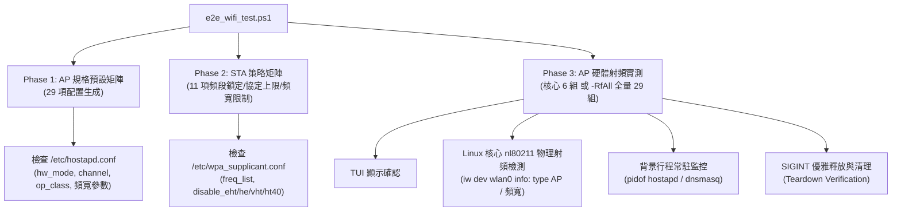

# QWiFiTestTool E2E 自動化測試腳本指南

本手冊說明 [`scripts/e2e_wifi_test.ps1`](file:///d:/QWiFiTestTool/QWifiTestTool/scripts/e2e_wifi_test.ps1) 的架構設計、支援功能、命令列參數與執行範例。

---

## 1. 腳本定位與架構

`e2e_wifi_test.ps1` 專為 ARM64 Linux 開發板（搭配 Qualcomm WCN7851-5 / FME170Q-865 等網卡）設計，透過 ADB 連線控制板端 `/data/local/tmp/QWifiTestTool`，提供 **TUI 選單驅動 + 配置生成驗證 + Linux 核心硬體射頻 (RF) 物理閉環測試**。

### 三層測試架構



---

## 2. 支援參數一覽

腳本定義參數如下：

| 參數 | 類型 | 說明 | 適用情境 |
|:---|:---:|:---|:---|
| *(無參數)* | Default | 執行完整分層測試：**Phase 1 (29項) + Phase 2 (11項) + Phase 3 核心射頻 (6項)** | 日常 CI/CD 或標準回歸測試 |
| `-RfAll` | Switch | **全量 29 組 AP 硬體射頻實測**（略過 Phase 1 & 2，全跑 6G/5G/2.4G 實體射頻廣播） | 晶片 RF 物理層完整相容性驗收 |
| `-RfOnly` | Switch | **核心 6 組 AP 跨頻段射頻實測**（略過 Phase 1 & 2，快速驗證硬體發射能力） | 快速驗證板端 RF 發射與驅動狀態 |
| `-MatrixOnly`| Switch | **僅執行靜態配置生成矩陣**（Phase 1 + Phase 2 共 40 項，不啟動射頻廣播） | 快速驗證 TUI 選單邏輯與設定檔生成 |
| `-ApOnly` | Switch | **僅測試 AP 相關項目**（排除 Phase 2 STA 策略） | 專注於 AP 熱點功能驗證 |
| `-StaOnly` | Switch | **僅測試 STA 相關項目**（排除 Phase 1 & Phase 3 AP 項目） | 專注於 STA 頻段鎖定與協定限制驗證 |

---

## 3. 測試用例覆蓋矩陣

### Phase 1: AP 規格預設全矩陣（29 項）

| 頻段 | TC ID | 測試案例名稱 | 協議 | 頻寬 | 核心驗證 Token |
|:---:|:---|:---|:---:|:---:|:---|
| **6 GHz** | TC-AP-M01 | 6GHz WiFi 7 320M | 802.11be | 320 MHz | `hw_mode=a`, `channel=37`, `ieee80211be=1`, `op_class=137` |
| | TC-AP-M02 | 6GHz WiFi 7 160M | 802.11be | 160 MHz | `hw_mode=a`, `channel=37`, `ieee80211be=1`, `op_class=134` |
| | TC-AP-M03 | 6GHz WiFi 7 80M | 802.11be | 80 MHz | `hw_mode=a`, `channel=37`, `ieee80211be=1`, `op_class=133` |
| | TC-AP-M04 | 6GHz WiFi 7 40M | 802.11be | 40 MHz | `hw_mode=a`, `channel=37`, `ieee80211be=1`, `op_class=132` |
| | TC-AP-M05 | 6GHz WiFi 7 20M | 802.11be | 20 MHz | `hw_mode=a`, `channel=37`, `ieee80211be=1`, `op_class=131` |
| | TC-AP-M06 | 6GHz WiFi 6 160M | 802.11ax | 160 MHz | `hw_mode=a`, `channel=37`, `ieee80211ax=1`, `op_class=134` |
| | TC-AP-M07 | 6GHz WiFi 6 80M | 802.11ax | 80 MHz | `hw_mode=a`, `channel=37`, `ieee80211ax=1`, `op_class=133` |
| | TC-AP-M08 | 6GHz WiFi 6 40M | 802.11ax | 40 MHz | `hw_mode=a`, `channel=37`, `ieee80211ax=1`, `op_class=132` |
| | TC-AP-M09 | 6GHz WiFi 6 20M | 802.11ax | 20 MHz | `hw_mode=a`, `channel=37`, `ieee80211ax=1`, `op_class=131` |
| **5 GHz** | TC-AP-M10 | 5GHz WiFi 7 160M | 802.11be | 160 MHz | `hw_mode=a`, `channel=36`, `ieee80211be=1`, `vht_oper_centr_freq_seg0_idx=50` |
| | TC-AP-M11 | 5GHz WiFi 7 80M | 802.11be | 80 MHz | `hw_mode=a`, `channel=36`, `ieee80211be=1`, `vht_oper_centr_freq_seg0_idx=42` |
| | TC-AP-M12 | 5GHz WiFi 7 40M | 802.11be | 40 MHz | `hw_mode=a`, `channel=36`, `ieee80211be=1` |
| | TC-AP-M13 | 5GHz WiFi 7 20M | 802.11be | 20 MHz | `hw_mode=a`, `channel=36`, `ieee80211be=1` |
| | TC-AP-M14 | 5GHz WiFi 6 160M | 802.11ax | 160 MHz | `hw_mode=a`, `channel=36`, `ieee80211ax=1`, `vht_oper_centr_freq_seg0_idx=50` |
| | TC-AP-M15 | 5GHz WiFi 6 80M | 802.11ax | 80 MHz | `hw_mode=a`, `channel=36`, `ieee80211ax=1`, `vht_oper_centr_freq_seg0_idx=42` |
| | TC-AP-M16 | 5GHz WiFi 6 40M | 802.11ax | 40 MHz | `hw_mode=a`, `channel=36`, `ieee80211ax=1` |
| | TC-AP-M17 | 5GHz WiFi 6 20M | 802.11ax | 20 MHz | `hw_mode=a`, `channel=36`, `ieee80211ax=1` |
| | TC-AP-M18 | 5GHz WiFi 5 160M | 802.11ac | 160 MHz | `hw_mode=a`, `channel=36`, `ieee80211ac=1`, `vht_oper_centr_freq_seg0_idx=50` |
| | TC-AP-M19 | 5GHz WiFi 5 80M | 802.11ac | 80 MHz | `hw_mode=a`, `channel=36`, `ieee80211ac=1`, `vht_oper_centr_freq_seg0_idx=42` |
| | TC-AP-M20 | 5GHz WiFi 5 40M | 802.11ac | 40 MHz | `hw_mode=a`, `channel=36`, `ieee80211ac=1` |
| | TC-AP-M21 | 5GHz WiFi 5 20M | 802.11ac | 20 MHz | `hw_mode=a`, `channel=36`, `ieee80211ac=1` |
| | TC-AP-M22 | 5GHz WiFi 4 40M | 802.11n | 40 MHz | `hw_mode=a`, `channel=36`, `ieee80211n=1` |
| | TC-AP-M23 | 5GHz WiFi 4 20M | 802.11n | 20 MHz | `hw_mode=a`, `channel=36`, `ieee80211n=1` |
| **2.4 GHz** | TC-AP-M24 | 2.4GHz WiFi 7 40M | 802.11be | 40 MHz | `hw_mode=g`, `channel=6`, `ieee80211be=1` |
| | TC-AP-M25 | 2.4GHz WiFi 7 20M | 802.11be | 20 MHz | `hw_mode=g`, `channel=6`, `ieee80211be=1` |
| | TC-AP-M26 | 2.4GHz WiFi 6 40M | 802.11ax | 40 MHz | `hw_mode=g`, `channel=6`, `ieee80211ax=1` |
| | TC-AP-M27 | 2.4GHz WiFi 6 20M | 802.11ax | 20 MHz | `hw_mode=g`, `channel=6`, `ieee80211ax=1` |
| | TC-AP-M28 | 2.4GHz WiFi 4 40M | 802.11n | 40 MHz | `hw_mode=g`, `channel=6`, `ieee80211n=1` |
| | TC-AP-M29 | 2.4GHz WiFi 4 20M | 802.11n | 20 MHz | `hw_mode=g`, `channel=6`, `ieee80211n=1` |

---

### Phase 2: STA 策略矩陣與硬體射頻掃描閉環（11 項）

在非 `-MatrixOnly` 模式下，STA 頻段鎖定會直接驅動網卡物理層執行 **實體 RF 掃描過濾閉環（Approach A）**，發射硬體 Probe Request 並驗證空氣中搜得的 AP 頻率邊界，嚴禁任何頻譜洩漏（RF Leakage）。

> **V1.10 穩健性改進**：
> - `iw scan flush` 回傳錯誤（`Operation not permitted`、`command failed`、`No such device`、`Device or resource busy`）時，該測試直接判定 **FAIL** 而非靜默通過。
> - 掃描結果為 0 BSS 時（如屏蔽室環境），不再報告假 PASS，改標示為 **inconclusive**（無法驗證頻段邊界）。

| 策略分類 | TC ID | 測試案例名稱 | 驗證 Expected Tokens | 排除 Forbidden Tokens | 物理層硬體 RF 掃描閉環驗證 (`iw scan flush`) |
|:---|:---|:---|:---|:---|:---|
| **頻段鎖定** | TC-STA-P01 | STA 6GHz Band Lock | `freq_list=5955` | - | **實體 6G 閉環**：僅允許 5945~7125 MHz，嚴禁 2.4G/5G 洩漏 |
| | TC-STA-P02 | STA 5GHz Lock (Exclude DFS) | `5180` | `5260`, `5280` | **實體 5G 閉環**：僅允許 5G 非 DFS 頻率，嚴禁 DFS 頻段與 2.4G |
| | TC-STA-P03 | STA 5GHz Lock (Include DFS) | `5180`, `5260` | - | **實體 5G 閉環**：包含 DFS 頻道，嚴禁 2.4G 頻率洩漏 |
| | TC-STA-P04 | STA 2.4GHz Band Lock | `2412`, `2437` | - | **實體 2.4G 閉環**：僅允許 2400~2500 MHz，嚴禁 5G/6G 洩漏 |
| | TC-STA-P05 | STA Clear Band Lock | *(清空頻段限制)* | `freq_list=` | **全頻實體掃描**：全頻段開放，空氣中同時捕獲 2.4G/5G/6G AP |
| **協定上限** | TC-STA-P06 | STA Protocol Cap: Max WiFi 6 | `disable_eht=1` | - | *(靜態協定限制 IE 斷言)* |
| | TC-STA-P07 | STA Protocol Cap: Max WiFi 5 | `disable_eht=1`, `disable_he=1` | - | *(靜態協定限制 IE 斷言)* |
| | TC-STA-P08 | STA Protocol Cap: Max WiFi 4 | `disable_eht=1`, `disable_he=1`, `disable_vht=1` | - | *(靜態協定限制 IE 斷言)* |
| | TC-STA-P09 | STA Clear Protocol Cap | *(清空協定限制)* | `disable_eht=1`, `disable_he=1`, `disable_vht=1` | *(靜態協定限制 IE 斷言)* |
| **頻寬上限** | TC-STA-P10 | STA Bandwidth Cap: Force 20MHz | `disable_ht40=1` | - | *(強制 20MHz 測試，抑制 HT40 及寬頻寬)* |
| | TC-STA-P11 | STA Clear Bandwidth Cap | *(清空頻寬限制)* | `disable_ht40=1` | *(靜態頻寬限制斷言)* |

---

### Phase 3: AP 硬體射頻實體廣播（TC-RF-01 ~ TC-RF-29）

使用 `-RfAll` 模式時執行全量 29 項實體發射，預設或 `-RfOnly` 執行標註為 **(Core)** 的 6 組核心案例：

| TC ID | 規格名稱 | 頻段 | 核心標記 | 物理檢測標準 (`iw dev wlan0 info`) |
|:---|:---|:---:|:---:|:---|
| **TC-RF-01** | 6GHz WiFi 7 320M RF TX | 6 GHz | **Core** | `type AP`, `320 MHz` (center1: 6105) |
| **TC-RF-02** | 6GHz WiFi 7 160M RF TX | 6 GHz | Full | `type AP`, `160 MHz` (Center: 47) |
| **TC-RF-03** | 6GHz WiFi 7 80M RF TX | 6 GHz | Full | `type AP`, `80 MHz` (Center: 39) |
| **TC-RF-04** | 6GHz WiFi 7 40M RF TX | 6 GHz | Full | `type AP`, `40 MHz` (Center: 35) |
| **TC-RF-05** | 6GHz WiFi 7 20M RF TX | 6 GHz | Full | `type AP`, `20 MHz` (channel 37) |
| **TC-RF-06** | 6GHz WiFi 6 160M RF TX | 6 GHz | **Core** | `type AP`, `160 MHz` (Center: 47) |
| **TC-RF-07** | 6GHz WiFi 6 80M RF TX | 6 GHz | Full | `type AP`, `80 MHz` (Center: 39) |
| **TC-RF-08** | 6GHz WiFi 6 40M RF TX | 6 GHz | Full | `type AP`, `40 MHz` (Center: 35) |
| **TC-RF-09** | 6GHz WiFi 6 20M RF TX | 6 GHz | Full | `type AP`, `20 MHz` (channel 37) |
| **TC-RF-10** | 5GHz WiFi 7 160M RF TX | 5 GHz | **Core** | `type AP`, `160 MHz` (Center: 50) |
| **TC-RF-11** | 5GHz WiFi 7 80M RF TX | 5 GHz | Full | `type AP`, `80 MHz` (Center: 42) |
| **TC-RF-12** | 5GHz WiFi 7 40M RF TX | 5 GHz | Full | `type AP`, `40 MHz` (channel 36) |
| **TC-RF-13** | 5GHz WiFi 7 20M RF TX | 5 GHz | Full | `type AP`, `20 MHz` (channel 36) |
| **TC-RF-14** | 5GHz WiFi 6 160M RF TX | 5 GHz | Full | `type AP`, `160 MHz` (Center: 50) |
| **TC-RF-15** | 5GHz WiFi 6 80M RF TX | 5 GHz | Full | `type AP`, `80 MHz` (Center: 42) |
| **TC-RF-16** | 5GHz WiFi 6 40M RF TX | 5 GHz | Full | `type AP`, `40 MHz` (channel 36) |
| **TC-RF-17** | 5GHz WiFi 6 20M RF TX | 5 GHz | Full | `type AP`, `20 MHz` (channel 36) |
| **TC-RF-18** | 5GHz WiFi 5 160M RF TX | 5 GHz | Full | `type AP`, `160 MHz` (Center: 50) |
| **TC-RF-19** | 5GHz WiFi 5 80M RF TX | 5 GHz | **Core** | `type AP`, `80 MHz` (Center: 42) |
| **TC-RF-20** | 5GHz WiFi 5 40M RF TX | 5 GHz | Full | `type AP`, `40 MHz` (channel 36) |
| **TC-RF-21** | 5GHz WiFi 5 20M RF TX | 5 GHz | Full | `type AP`, `20 MHz` (channel 36) |
| **TC-RF-22** | 5GHz WiFi 4 40M RF TX | 5 GHz | Full | `type AP`, `40 MHz` (channel 36) |
| **TC-RF-23** | 5GHz WiFi 4 20M RF TX | 5 GHz | Full | `type AP`, `20 MHz` (channel 36) |
| **TC-RF-24** | 2.4GHz WiFi 7 40M RF TX | 2.4 GHz | Full | `type AP`, `40 MHz` / `20 MHz` (channel 6) |
| **TC-RF-25** | 2.4GHz WiFi 7 20M RF TX | 2.4 GHz | **Core** | `type AP`, `20 MHz` (channel 6) |
| **TC-RF-26** | 2.4GHz WiFi 6 40M RF TX | 2.4 GHz | Full | `type AP`, `40 MHz` / `20 MHz` (channel 6) |
| **TC-RF-27** | 2.4GHz WiFi 6 20M RF TX | 2.4 GHz | Full | `type AP`, `20 MHz` (channel 6) |
| **TC-RF-28** | 2.4GHz WiFi 4 40M RF TX | 2.4 GHz | Full | `type AP`, `40 MHz` / `20 MHz` (channel 6) |
| **TC-RF-29** | 2.4GHz WiFi 4 20M RF TX | 2.4 GHz | **Core** | `type AP`, `20 MHz` (channel 6) |

---

## 4. 執行方式與範例

### 前置條件
1. Windows 主機已安裝 PowerShell 5.1+ 與 Android SDK Platform Tools (`adb` 位於 PATH 中)。
2. 開發板透過 USB/網口連線，確認 `adb devices` 狀態正常。
3. 板端已部署可執行檔 `/data/local/tmp/QWifiTestTool`。
4. `qwt_board_cleanup.sh` 與 `e2e_wifi_test.ps1` 位於同一目錄（測試啟動時自動推送到板端）。

### 範例指令

#### A. 全量實體硬體射頻測試（29 組全量實測）
適合全面驗證 RF 發射規格、PCIe/nl80211 驅動頻寬設定：
```powershell
powershell -ExecutionPolicy Bypass -File .\scripts\e2e_wifi_test.ps1 -RfAll
```

#### B. 快速靜態矩陣驗證（約 1 分鐘）
適合日常修改程式碼後快速回歸測試配置生成邏輯：
```powershell
powershell -ExecutionPolicy Bypass -File .\scripts\e2e_wifi_test.ps1 -MatrixOnly
```

#### C. 僅測試 AP 靜態矩陣（29 項）
```powershell
powershell -ExecutionPolicy Bypass -File .\scripts\e2e_wifi_test.ps1 -MatrixOnly -ApOnly
```

#### D. 僅測試 STA 頻段鎖定、協定上限與頻寬限制（11 項）
```powershell
powershell -ExecutionPolicy Bypass -File .\scripts\e2e_wifi_test.ps1 -StaOnly
```

#### E. 核心 6 組跨頻段射頻實測
```powershell
powershell -ExecutionPolicy Bypass -File .\scripts\e2e_wifi_test.ps1 -RfOnly
```

#### F. 標準完整分層測試（Phase 1 29項 + Phase 2 11項 + Phase 3 核心射頻 6項）
```powershell
powershell -ExecutionPolicy Bypass -File .\scripts\e2e_wifi_test.ps1
```

---

## 5. 輸出報告範例

測試結束後，腳本會自動彙整 Markdown 格式的驗證匯總報告：

```markdown
===============================================================================================
### QWiFiTestTool Comprehensive E2E Verification Report (FME170Q)
- Time: 2026-09-16 17:30:11
- Target Module: Qualcomm FME170Q-865 (WCN7851-5)
- Target Kernel: 5.10.160-ab915

| Category | TC ID | Test Case | Status | Verification Details |
|:---|:---|:---|:---:|:---|
| AP Hardware RF | TC-RF-01 | 6GHz WiFi 7 320M RF TX | [PASS] | Physical RF 320 MHz perfectly matched, teardown clean |
| AP Hardware RF | TC-RF-02 | 6GHz WiFi 7 160M RF TX | [PASS] | Physical RF 160 MHz perfectly matched, teardown clean |
...
| AP Hardware RF | TC-RF-29 | 2.4GHz WiFi 4 20M RF TX | [PASS] | Physical RF 20 MHz perfectly matched, teardown clean |
===============================================================================================

>> Summary: Total 29 | Passed: 29 | Failed: 0 | Pass Rate: 100%
```

---

## 6. V1.10 穩健性改進

### 6.1 iw scan 錯誤偵測

`iw dev wlan0 scan flush` 可能因權限不足、裝置忙碌等原因失敗。V1.10 新增錯誤字串偵測：

| 錯誤訊息 | 原因 | 影響的測試 |
|:---|:---|:---|
| `Operation not permitted` | 非 root 或 capabilities 不足 | TC-STA-P01~P05 |
| `command failed` | nl80211 驅動層拒絕掃描請求 | TC-STA-P01~P05 |
| `No such device` | wlan0 介面不存在或未 up | TC-STA-P01~P05 |
| `Device or resource busy` | wpa_supplicant 或 hostapd 佔用介面 | TC-STA-P01~P05 |

偵測到上述錯誤時，測試直接判定 **FAIL**，不再靜默通過。

### 6.2 0-BSS 假陽性防護

在屏蔽室或 RF 靜默環境下，`iw scan` 可能回傳 0 個 BSS。V1.10 前這會因「無頻率洩漏」而假 PASS。

現在 0 BSS 結果標示為 `inconclusive`（無法驗證頻段邊界），測試仍 PASS 但報告中明確註記：

```
Policy verified + RF Scan: 0 BSS (inconclusive, cannot verify band boundary)
```

### 6.3 ReadLineAsync 超時防護

Phase 3 AP 射頻測試使用 `ReadLineAsync()` + `.Wait(1000ms)` 取代同步 `ReadLine()`。
當 TUI 停止輸出時，30 秒 timeout 迴圈正確觸發超時並報 FAIL，避免腳本永久掛起。

---

## 7. V1.13 穩健性與架構改進

### 7.1 DFS 頻道可用性檢查 (CAC) 狀態機閉環
在 5GHz 160MHz 或 DFS 頻道 (ch52~144) 啟動 AP 時，內核與法規要求執行 60 秒 CAC 掃描。
- **問題**：CAC 期間 `iw dev wlan0 info` 已切換為 `type AP`（尚未廣播 Beacon），舊版在第 1 秒即判定成功，導致 75 秒 CAC 等待無效並產生假 PASS。
- **閉環機制**：
  1. 優先使用 `hostapd_cli status` 檢查 `state=ENABLED`。
  2. 若無 CLI 則解析 hostapd 內部日誌，監聽 `DFS-CAC-START`、`DFS-CAC-COMPLETED success=1` 與 `AP-ENABLED` 事件，確保真實發射 Beacon 後才回報 AP Ready。
  3. `e2e_wifi_test.ps1` 針對 5GHz 160M 測試案例自動動態擴展超時至 120 秒，避免 CAC 等待超時。

### 7.2 Realtek 模組 5GHz DFS 依賴修復
hostapd 內部邏輯強制要求：若宣告 `ieee80211h=1`，必須同時宣告 `ieee80211d=1` 與 `country_code`，否則 hostapd 直接退出。
- Realtek 驅動（如 RTL8852BE）由模組參數 `rtw_country_code` 處理法規域，原程式碼略過寫入 `country_code`，導致 DFS 頻道必定啟動失敗。
- V1.13 在 DFS 頻道強制補齊 `country_code` 與 `ieee80211d=1`，確保各廠牌晶片 DFS 規格全相容。

### 7.3 PowerShell 5.1 指令跳脫與 UTF-8 BOM 編碼修復
- **`disable_ht40` 指令探測**：修正 PS 5.1 雙引號傳遞截斷問題，改為單引號傳送，避免 STA 頻寬上限測試產生誤發輸入。
- **UTF-8 with BOM 編碼**：確保在不同語系 Windows PowerShell 5.1 環境中，正則匹配字串不發生編碼錯亂。
- **全量 29 組 AP 實測**：使用 `-RfAll` 在 Qualcomm FME170Q-865 實測達成 **29 / 29 PASS (100%)**。

---

## 8. V1.14 穩健性與架構改進

### 8.1 雙軌設定檔生成機制收斂與 WPA3 自動防護
- 收斂 `generator.go` 與 `wpa_editor.go`，避免後台生成與 TUI 編輯器邏輯分歧。
- 支援讀取 XML 中的 `network_` 前綴參數（`network_ssid` / `network_sae_password`），優先採用傳入參數，缺省時由 XML 自動補齊。
- 偵測到 `SAE` 認證時，自動注入 `ieee80211w=2` (PMF 強制)；若未指定預設 SSID，保證不輸出無效的空 `network={}` 區塊，防止 `wpa_supplicant` 解析報錯退出。

### 8.2 行程與訊號管理對稱性 (Ctrl+C 優雅中斷與資源防護)
- **CAC 等待即刻響應**：將信號通道提早註冊至服務啟動階段，在 60 秒 CAC 等待循環中透過 select 監聽 `sigChan`，按 Ctrl+C 可隨時中斷 AP 啟動並清理資源，不再阻塞 60 秒。
- **STA 行程追蹤與路由隔離**：追蹤 `wpaCmd` 指針並在退出時直殺子行程；退出清理時追加 `ip route flush dev <iface>` 與 link down，嚴格局限於指定無線網卡，不波及系統 `eth0` 實體網卡。

### 8.3 驅動健全性檢查 (Sanity Check) 強化與動態參數比對
- **PreloadKo 多模組檢查**：Sanity Check 擴充支援 `module.Kernel.GetPreloadKoList()`，逐一核對依賴模組載入狀態，自動排除 `pcie-dw-*` built-in 模組誤報。
- **動態參數比對與重載提示**：比對 `/sys/module/<modName>/parameters/` 內核參數與 XML 預期值，不一致時主動提示重新卸載載入。
- **UnloadDriver 卸載防護**：卸載前先主動停用網路介面與殺除佔用行程，消除 `Module is in use` 卸載失敗。

### 8.4 可執行檔多層級搜尋策略 (消除 PATH 盲區)
- `FindCommand` 擴充為四層搜尋策略：`$PATH` ➔ 自身目錄 ➔ `/usr/sbin` 系統目錄 ➔ fallback。
- 自動識別 `wpa_supplicant_s1g`、`hostapd_s1g`、`dnsmasq` 等工具，徹底解決 Buildroot / Busybox / Android 最小化發行版下的指令路徑找不到問題。

### 8.5 XML 單一真理源重構 (package assets embed)
- 將 `assets/default_modules.xml` 透過 `assets/modules.go` 原生內嵌，廢除 `internal/models/` 內的複本。
- 移除各類建置腳本中複製 XML 的邏輯，徹底根絕 IDE/終端直接編譯時的幽靈不同步問題。
- 執行期雙軌防護：板端外部 XML 優先讀取（現場免編譯調校），外部檔案不存在時無縫 fallback 內嵌資料（防漏推保底）。

---

## 9. V1.16 網卡範圍清理

### 9.1 板端清理腳本 `qwt_board_cleanup.sh`
- 原本 `Cleanup-Environment` 與 STA/RF 測項對 `udhcpc`、`dhclient`、`dnsmasq`、`wpa_supplicant`、`hostapd` 全域 `killall -9`，在 eth0 走 DHCP 的板子上會殺掉 eth0 的 DHCP client，租約到期後斷網。
- 改由 `qwt_board_cleanup.sh <iface> [process-name ...]` 清理，規則與 QWifiTestTool 本體 (`internal/sys/proc_iface.go`) 一致：
  - `QWifiTestTool`：一律清理。
  - `udhcpc` / `dhclient`：僅清理綁定 `<iface>` 者。
  - `dnsmasq`：宣告介面含 `<iface>`，或完全未宣告介面 (wildcard / 僅 `listen-address` / 設定檔已刪除) 時清理。
  - `wpa_supplicant[_s1g]` / `hostapd[_s1g]`：綁定 `<iface>` 或未宣告網卡 (D-Bus 模式等) 時清理；明確只綁其他網卡者保留。
- POSIX sh 實作 (bash / busybox ash 皆可)。腳本在推送前自動轉為 LF 換行，避免 CRLF checkout 導致板端執行失敗。
- `--dry-run` 只列出 `PID 名稱`，不實際終止，可用於手動確認。

### 9.2 RF teardown 斷言
- 「hostapd 執行中 (Assertion 3)」與「停止後無殘留 (Assertion 4)」由全域 `pidof hostapd` 改為 `qwt_board_cleanup.sh --dry-run wlan0 hostapd hostapd_s1g`，只看測試網卡。

### 9.3 驗證
- 在板上放置 4 個綁定 eth9 的對照 daemon (comm 與真實名稱相同，舊版全域 `killall` 會殺掉)，完整 E2E 執行全程存活，且全部測項 PASS。
