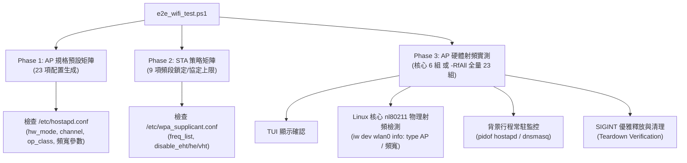

# QWiFiTestTool E2E 自動化測試腳本指南

本手冊說明 [`scripts/e2e_wifi_test.ps1`](file:///d:/QWiFiTestTool/QWifiTestTool/scripts/e2e_wifi_test.ps1) 的架構設計、支援功能、命令列參數與執行範例。

---

## 1. 腳本定位與架構

`e2e_wifi_test.ps1` 專為 ARM64 Linux 開發板（搭配 Qualcomm WCN7851-5 / FME170Q-865 等網卡）設計，透過 ADB 連線控制板端 `/data/local/tmp/QWifiTestTool`，提供 **TUI 選單驅動 + 配置生成驗證 + Linux 核心硬體射頻 (RF) 物理閉環測試**。

### 三層測試架構



---

## 2. 支援參數一覽

腳本定義參數如下：

| 參數 | 類型 | 說明 | 適用情境 |
|:---|:---:|:---|:---|
| *(無參數)* | Default | 執行完整分層測試：**Phase 1 (23項) + Phase 2 (9項) + Phase 3 核心射頻 (6項)** | 日常 CI/CD 或標準回歸測試 |
| `-RfAll` | Switch | **全量 23 組 AP 硬體射頻實測**（略過 Phase 1 & 2，全跑 6G/5G/2.4G 實體射頻廣播） | 晶片 RF 物理層完整相容性驗收 |
| `-RfOnly` | Switch | **核心 6 組 AP 跨頻段射頻實測**（略過 Phase 1 & 2，快速驗證硬體發射能力） | 快速驗證板端 RF 發射與驅動狀態 |
| `-MatrixOnly`| Switch | **僅執行靜態配置生成矩陣**（Phase 1 + Phase 2 共 32 項，不啟動射頻廣播） | 快速驗證 TUI 選單邏輯與設定檔生成 |
| `-ApOnly` | Switch | **僅測試 AP 相關項目**（排除 Phase 2 STA 策略） | 專注於 AP 熱點功能驗證 |
| `-StaOnly` | Switch | **僅測試 STA 相關項目**（排除 Phase 1 & Phase 3 AP 項目） | 專注於 STA 頻段鎖定與協定限制驗證 |

---

## 3. 測試用例覆蓋矩陣

### Phase 1: AP 規格預設全矩陣（23 項）

| 頻段 | TC ID | 測試案例名稱 | 協議 | 頻寬 | 核心驗證 Token |
|:---:|:---|:---|:---:|:---:|:---|
| **6 GHz** | TC-AP-M01 | 6GHz WiFi 7 320M | 802.11be | 320 MHz | `hw_mode=a`, `channel=37`, `ieee80211be=1`, `op_class=137` |
| | TC-AP-M02 | 6GHz WiFi 7 160M | 802.11be | 160 MHz | `hw_mode=a`, `channel=37`, `ieee80211be=1`, `op_class=134` |
| | TC-AP-M03 | 6GHz WiFi 7 80M | 802.11be | 80 MHz | `hw_mode=a`, `channel=37`, `ieee80211be=1`, `op_class=133` |
| | TC-AP-M04 | 6GHz WiFi 6 160M | 802.11ax | 160 MHz | `hw_mode=a`, `channel=37`, `ieee80211ax=1`, `op_class=134` |
| | TC-AP-M05 | 6GHz WiFi 6 80M | 802.11ax | 80 MHz | `hw_mode=a`, `channel=37`, `ieee80211ax=1`, `op_class=133` |
| | TC-AP-M06 | 6GHz WiFi 6 40M | 802.11ax | 40 MHz | `hw_mode=a`, `channel=37`, `ieee80211ax=1`, `op_class=132` |
| | TC-AP-M07 | 6GHz WiFi 6 20M | 802.11ax | 20 MHz | `hw_mode=a`, `channel=37`, `ieee80211ax=1`, `op_class=131` |
| **5 GHz** | TC-AP-M08 | 5GHz WiFi 7 160M | 802.11be | 160 MHz | `hw_mode=a`, `channel=36`, `ieee80211be=1`, `vht_oper_centr_freq_seg0_idx=50` |
| | TC-AP-M09 | 5GHz WiFi 7 80M | 802.11be | 80 MHz | `hw_mode=a`, `channel=36`, `ieee80211be=1`, `vht_oper_centr_freq_seg0_idx=42` |
| | TC-AP-M10 | 5GHz WiFi 6 160M | 802.11ax | 160 MHz | `hw_mode=a`, `channel=36`, `ieee80211ax=1`, `vht_oper_centr_freq_seg0_idx=50` |
| | TC-AP-M11 | 5GHz WiFi 6 80M | 802.11ax | 80 MHz | `hw_mode=a`, `channel=36`, `ieee80211ax=1`, `vht_oper_centr_freq_seg0_idx=42` |
| | TC-AP-M12 | 5GHz WiFi 6 40M | 802.11ax | 40 MHz | `hw_mode=a`, `channel=36`, `ieee80211ax=1` |
| | TC-AP-M13 | 5GHz WiFi 6 20M | 802.11ax | 20 MHz | `hw_mode=a`, `channel=36`, `ieee80211ax=1` |
| | TC-AP-M14 | 5GHz WiFi 5 80M | 802.11ac | 80 MHz | `hw_mode=a`, `channel=36`, `ieee80211ac=1`, `vht_oper_centr_freq_seg0_idx=42` |
| | TC-AP-M15 | 5GHz WiFi 5 40M | 802.11ac | 40 MHz | `hw_mode=a`, `channel=36`, `ieee80211ac=1` |
| | TC-AP-M16 | 5GHz WiFi 4 40M | 802.11n | 40 MHz | `hw_mode=a`, `channel=36`, `ieee80211n=1` |
| | TC-AP-M17 | 5GHz WiFi 4 20M | 802.11n | 20 MHz | `hw_mode=a`, `channel=36`, `ieee80211n=1` |
| **2.4 GHz** | TC-AP-M18 | 2.4GHz WiFi 7 40M | 802.11be | 40 MHz | `hw_mode=g`, `channel=6`, `ieee80211be=1` |
| | TC-AP-M19 | 2.4GHz WiFi 7 20M | 802.11be | 20 MHz | `hw_mode=g`, `channel=6`, `ieee80211be=1` |
| | TC-AP-M20 | 2.4GHz WiFi 6 40M | 802.11ax | 40 MHz | `hw_mode=g`, `channel=6`, `ieee80211ax=1` |
| | TC-AP-M21 | 2.4GHz WiFi 6 20M | 802.11ax | 20 MHz | `hw_mode=g`, `channel=6`, `ieee80211ax=1` |
| | TC-AP-M22 | 2.4GHz WiFi 4 40M | 802.11n | 40 MHz | `hw_mode=g`, `channel=6`, `ieee80211n=1` |
| | TC-AP-M23 | 2.4GHz WiFi 4 20M | 802.11n | 20 MHz | `hw_mode=g`, `channel=6`, `ieee80211n=1` |

---

### Phase 2: STA 策略矩陣與硬體射頻掃描閉環（9 項）

在非 `-MatrixOnly` 模式下，STA 頻段鎖定會直接驅動網卡物理層執行 **實體 RF 掃描過濾閉環（Approach A）**，發射硬體 Probe Request 並驗證空氣中搜得的 AP 頻率邊界，嚴禁任何頻譜洩漏（RF Leakage）。

> **V1.10 穩健性改進**：
> - `iw scan flush` 回傳錯誤（`Operation not permitted`、`command failed`、`No such device`、`Device or resource busy`）時，該測試直接判定 **FAIL** 而非靜默通過。
> - 掃描結果為 0 BSS 時（如屏蔽室環境），不再報告假 PASS，改標示為 **inconclusive**（無法驗證頻段邊界）。

| 策略分類 | TC ID | 測試案例名稱 | 驗證 Expected Tokens | 排除 Forbidden Tokens | 物理層硬體 RF 掃描閉環驗證 (`iw scan flush`) |
|:---|:---|:---|:---|:---|:---|
| **頻段鎖定** | TC-STA-P01 | STA 6GHz Band Lock | `freq_list=5955` | - | **實體 6G 閉環**：僅允許 5945~7125 MHz，嚴禁 2.4G/5G 洩漏 |
| | TC-STA-P02 | STA 5GHz Lock (Exclude DFS) | `5180` | `5260`, `5280` | **實體 5G 閉環**：僅允許 5G 非 DFS 頻率，嚴禁 DFS 頻段與 2.4G |
| | TC-STA-P03 | STA 5GHz Lock (Include DFS) | `5180`, `5260` | - | **實體 5G 閉環**：包含 DFS 頻道，嚴禁 2.4G 頻率洩漏 |
| | TC-STA-P04 | STA 2.4GHz Band Lock | `2412`, `2437` | - | **實體 2.4G 閉環**：僅允許 2400~2500 MHz，嚴禁 5G/6G 洩漏 |
| | TC-STA-P05 | STA Clear Band Lock | *(清空頻段限制)* | `freq_list=` | **全頻實體掃描**：全頻段開放，空氣中同時捕獲 2.4G/5G/6G AP |
| **協定上限** | TC-STA-P06 | STA Protocol Cap: Max WiFi 6 | `disable_eht=1` | - | *(靜態協定限制 IE 斷言)* |
| | TC-STA-P07 | STA Protocol Cap: Max WiFi 5 | `disable_eht=1`, `disable_he=1` | - | *(靜態協定限制 IE 斷言)* |
| | TC-STA-P08 | STA Protocol Cap: Max WiFi 4 | `disable_eht=1`, `disable_he=1`, `disable_vht=1` | - | *(靜態協定限制 IE 斷言)* |
| | TC-STA-P09 | STA Clear Protocol Cap | *(清空協定限制)* | `disable_eht=1`, `disable_he=1`, `disable_vht=1` | *(靜態協定限制 IE 斷言)* |

---

### Phase 3: AP 硬體射頻實體廣播（TC-RF-01 ~ TC-RF-23）

使用 `-RfAll` 模式時執行全量 23 項實體發射，預設或 `-RfOnly` 執行標註為 **(Core)** 的 6 組核心案例：

| TC ID | 規格名稱 | 頻段 | 核心標記 | 物理檢測標準 (`iw dev wlan0 info`) |
|:---|:---|:---:|:---:|:---|
| **TC-RF-01** | 6GHz WiFi 7 320M RF TX | 6 GHz | **Core** | `type AP`, `320 MHz` (center1: 6105) |
| **TC-RF-02** | 6GHz WiFi 7 160M RF TX | 6 GHz | Full | `type AP`, `160 MHz` (Center: 47) |
| **TC-RF-03** | 6GHz WiFi 7 80M RF TX | 6 GHz | Full | `type AP`, `80 MHz` (Center: 39) |
| **TC-RF-04** | 6GHz WiFi 6 160M RF TX | 6 GHz | **Core** | `type AP`, `160 MHz` (Center: 47) |
| **TC-RF-05** | 6GHz WiFi 6 80M RF TX | 6 GHz | Full | `type AP`, `80 MHz` (Center: 39) |
| **TC-RF-06** | 6GHz WiFi 6 40M RF TX | 6 GHz | Full | `type AP`, `40 MHz` (Center: 35) |
| **TC-RF-07** | 6GHz WiFi 6 20M RF TX | 6 GHz | Full | `type AP`, `20 MHz` (channel 37) |
| **TC-RF-08** | 5GHz WiFi 7 160M RF TX | 5 GHz | **Core** | `type AP`, `160 MHz` (Center: 50) |
| **TC-RF-09** | 5GHz WiFi 7 80M RF TX | 5 GHz | Full | `type AP`, `80 MHz` (Center: 42) |
| **TC-RF-10** | 5GHz WiFi 6 160M RF TX | 5 GHz | Full | `type AP`, `160 MHz` (Center: 50) |
| **TC-RF-11** | 5GHz WiFi 6 80M RF TX | 5 GHz | Full | `type AP`, `80 MHz` (Center: 42) |
| **TC-RF-12** | 5GHz WiFi 6 40M RF TX | 5 GHz | Full | `type AP`, `40 MHz` (channel 36) |
| **TC-RF-13** | 5GHz WiFi 6 20M RF TX | 5 GHz | Full | `type AP`, `20 MHz` (channel 36) |
| **TC-RF-14** | 5GHz WiFi 5 80M RF TX | 5 GHz | **Core** | `type AP`, `80 MHz` (Center: 42) |
| **TC-RF-15** | 5GHz WiFi 5 40M RF TX | 5 GHz | Full | `type AP`, `40 MHz` (channel 36) |
| **TC-RF-16** | 5GHz WiFi 4 40M RF TX | 5 GHz | Full | `type AP`, `40 MHz` (channel 36) |
| **TC-RF-17** | 5GHz WiFi 4 20M RF TX | 5 GHz | Full | `type AP`, `20 MHz` (channel 36) |
| **TC-RF-18** | 2.4GHz WiFi 7 40M RF TX | 2.4 GHz | Full | `type AP`, `40 MHz` / `20 MHz` (channel 6) |
| **TC-RF-19** | 2.4GHz WiFi 7 20M RF TX | 2.4 GHz | **Core** | `type AP`, `20 MHz` (channel 6) |
| **TC-RF-20** | 2.4GHz WiFi 6 40M RF TX | 2.4 GHz | Full | `type AP`, `40 MHz` / `20 MHz` (channel 6) |
| **TC-RF-21** | 2.4GHz WiFi 6 20M RF TX | 2.4 GHz | Full | `type AP`, `20 MHz` (channel 6) |
| **TC-RF-22** | 2.4GHz WiFi 4 40M RF TX | 2.4 GHz | Full | `type AP`, `40 MHz` / `20 MHz` (channel 6) |
| **TC-RF-23** | 2.4GHz WiFi 4 20M RF TX | 2.4 GHz | **Core** | `type AP`, `20 MHz` (channel 6) |

---

## 4. 執行方式與範例

### 前置條件
1. Windows 主機已安裝 PowerShell 5.1+ 與 Android SDK Platform Tools (`adb` 位於 PATH 中)。
2. 開發板透過 USB/網口連線，確認 `adb devices` 狀態正常。
3. 板端已部署可執行檔 `/data/local/tmp/QWifiTestTool`。

### 範例指令

#### A. 全量實體硬體射頻測試（23 組全量實測）
適合全面驗證 RF 發射規格、PCIe/nl80211 驅動頻寬設定：
```powershell
powershell -ExecutionPolicy Bypass -File .\scripts\e2e_wifi_test.ps1 -RfAll
```

#### B. 快速靜態矩陣驗證（約 1 分鐘）
適合日常修改程式碼後快速回歸測試配置生成邏輯：
```powershell
powershell -ExecutionPolicy Bypass -File .\scripts\e2e_wifi_test.ps1 -MatrixOnly
```

#### C. 僅測試 AP 靜態矩陣（23 項）
```powershell
powershell -ExecutionPolicy Bypass -File .\scripts\e2e_wifi_test.ps1 -MatrixOnly -ApOnly
```

#### D. 僅測試 STA 頻段鎖定與協定上限（9 項）
```powershell
powershell -ExecutionPolicy Bypass -File .\scripts\e2e_wifi_test.ps1 -StaOnly
```

#### E. 核心 6 組跨頻段射頻實測
```powershell
powershell -ExecutionPolicy Bypass -File .\scripts\e2e_wifi_test.ps1 -RfOnly
```

#### F. 標準完整分層測試（Phase 1 + Phase 2 + Phase 3 核心射頻）
```powershell
powershell -ExecutionPolicy Bypass -File .\scripts\e2e_wifi_test.ps1
```

---

## 5. 輸出報告範例

測試結束後，腳本會自動彙整 Markdown 格式的驗證匯總報告：

```markdown
===============================================================================================
### QWiFiTestTool Comprehensive E2E Verification Report (FME170Q)
- Time: 2026-09-16 17:30:11
- Target Module: Qualcomm FME170Q-865 (WCN7851-5)
- Target Kernel: 5.10.160-ab915

| Category | TC ID | Test Case | Status | Verification Details |
|:---|:---|:---|:---:|:---|
| AP Hardware RF | TC-RF-01 | 6GHz WiFi 7 320M RF TX | [PASS] | Physical RF 320 MHz perfectly matched, teardown clean |
| AP Hardware RF | TC-RF-02 | 6GHz WiFi 7 160M RF TX | [PASS] | Physical RF 160 MHz perfectly matched, teardown clean |
...
| AP Hardware RF | TC-RF-23 | 2.4GHz WiFi 4 20M RF TX | [PASS] | Physical RF 20 MHz perfectly matched, teardown clean |
===============================================================================================

>> Summary: Total 23 | Passed: 23 | Failed: 0 | Pass Rate: 100%
```

---

## 6. V1.10 穩健性改進

### 6.1 iw scan 錯誤偵測

`iw dev wlan0 scan flush` 可能因權限不足、裝置忙碌等原因失敗。V1.10 新增錯誤字串偵測：

| 錯誤訊息 | 原因 | 影響的測試 |
|:---|:---|:---|
| `Operation not permitted` | 非 root 或 capabilities 不足 | TC-STA-P01~P05 |
| `command failed` | nl80211 驅動層拒絕掃描請求 | TC-STA-P01~P05 |
| `No such device` | wlan0 介面不存在或未 up | TC-STA-P01~P05 |
| `Device or resource busy` | wpa_supplicant 或 hostapd 佔用介面 | TC-STA-P01~P05 |

偵測到上述錯誤時，測試直接判定 **FAIL**，不再靜默通過。

### 6.2 0-BSS 假陽性防護

在屏蔽室或 RF 靜默環境下，`iw scan` 可能回傳 0 個 BSS。V1.10 前這會因「無頻率洩漏」而假 PASS。

現在 0 BSS 結果標示為 `inconclusive`（無法驗證頻段邊界），測試仍 PASS 但報告中明確註記：

```
Policy verified + RF Scan: 0 BSS (inconclusive, cannot verify band boundary)
```

### 6.3 ReadLineAsync 超時防護

Phase 3 AP 射頻測試使用 `ReadLineAsync()` + `.Wait(1000ms)` 取代同步 `ReadLine()`。
當 TUI 停止輸出時，30 秒 timeout 迴圈正確觸發超時並報 FAIL，避免腳本永久掛起。
